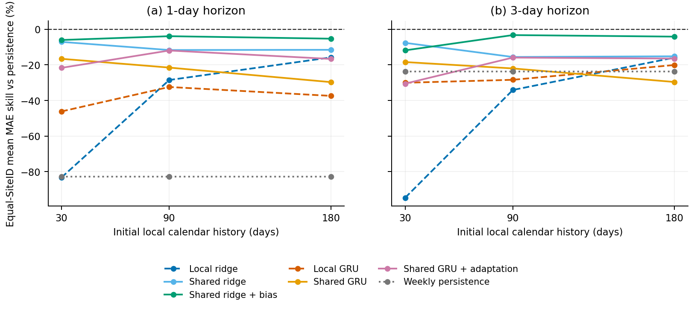

# Wessex有限本地历史预测：第二阶段真实开发交付

完成日期2026-10-10。10个原开发SiteID、3个固定种子、960/960任务、201600预测行；2024–2025未计算预测性能。全部负结果与原38条负预测保留，旧结果/审查/PDF/Overleaf原样保留在[上轮目录](../20261009)。本轮不重写论文或制作App。

先读[中文分析](ANALYSIS.md)。共享Ridge用30天历史比本地Ridge用90天历史，h1/h3等站改善15.25%/17.75%（各10/10）。但所有共享配置总体平均技能仍低于Persistence；B90共享偏差Ridge为−3.90%/−3.28%，并未证明超过强简单基线。高体积收益是次分析，不能替换主结果。

| 下载 | 大小 | 内容 |
|---|---:|---|
| [代码与派生数据](Wastewater_Stage2_Code_Data_20261010.zip?raw=true) | 0.97 MiB | 源码、配置、测试、协议、设施证据、QA-v3数据、Colab |
| [全部运行与检查点](Wastewater_Stage2_Runs_20261010.zip?raw=true) | 21.05 MiB | 逐条预测、960主任务与96smoke、来源搜索、状态、诊断、模型权重 |
| [指标、分析与图件](Wastewater_Stage2_Reports_Figures_20261010.zip?raw=true) | 6.12 MiB | 逐站/种子MAE/RMSE、负迁移、跨预算与相关性区间、4组PDF/SVG/PNG |

三个包均<24 MiB。按包内说明合并到同一ROOT；Colab importer校验各包SHA256SUMS后不落地清单、拒绝冲突覆盖。真实3包在新临时ROOT合并验证，96个smoke目标任务全部cached、无目标重训、23040行独立核查通过、原文件字节未变。见[包完整性](package_checks.json)、[整包重放](delivery_replay_checks.json)、[SHA256SUMS](SHA256SUMS)。

可单独下载[Colab notebook](Wessex_Shared_Development_v3.ipynb?raw=true)，先读[说明](COLAB_README.md)；本地非Drive核心已验证，真实Colab账号/Drive挂载/GPU未认证。CPU已实际完成本轮规模。[实验协议](EXPERIMENT_PROTOCOL.md)与[设施映射](FACILITY_MAPPING.csv)可直接查看。

[这张图的矢量PDF](budget_skill.pdf?raw=true)，其余图见报告包。量化曲线全部来自保存真实结果。

这是发布后Good QA的历史回顾、未核实物理独立性的SiteID探索。本地模型使用来源选定超参数，源/目标优化步数未匹配；不支持“已证明跨独立水厂实用收益”或水质/溢流/节能结论。下一步先核实设施与质量信息时点、增加受控开发对照，再决定是否冻结最终试验。

外部审查脚本validate_stage2_delivery.py是在包完成后新增，未改写任何ZIP。需要重新做整包验证时将它放入项目scripts/，按--help指定ZIP目录；现有验证JSON与脚本hash对应。代码版本由核心SHA、配置/data SHA和包内逐文件SHA标识。

按照用户已确认的仓库当前可见性，仅使用专用交付分支；main和旧交付分支不改。若仓库私有，请登录有权限的GitHub账号下载；远程Git对象校验不能替代用户浏览器下载验证。
