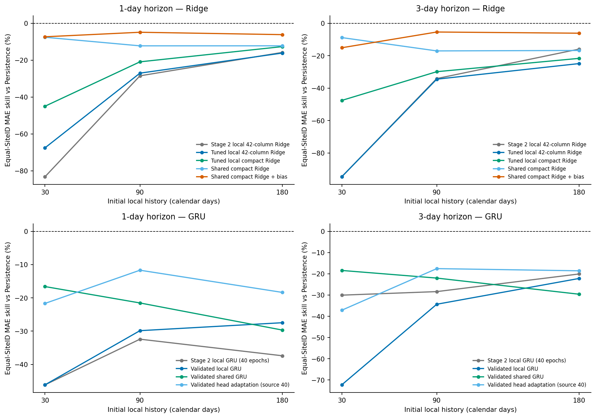

# Wessex Stage 3A：训练充分性与基线公平性诊断

Stage 3A已完成，**在此停止并等待审查，不执行Stage 3B。** 保留Stage 2原始代码、结果和档案；5040文件hash复核零变化。10个原开发SiteID、4个原窗口、B30/90/180、h1/3与原3种子不变，2024—2025未计算预测性能或用于选择。发布后QA为回顾处理，物理设施独立性和实时QA可用性未核实。

先读[中文分析](ANALYSIS_ZH.md)。简化Ridge和合法训练轮数选择改善部分本地基线，部分共享收益仍成立；但所有学习策略的全日期平均MAE技能仍低于Persistence。B90共享简化Ridge+偏差相对加强本地简化Ridge改善12.12%/17.54%；共享简化Ridge B30相对本地B90改善9.92%/14.84%（10/10站），仍不等于达到实用预测质量。延长GRU不是普遍有效的修复。

240/240开发条件、三固定种子完成，主比较388800行，另388800行固定训练端点诊断，4713/4800共同日期组。41项测试通过；独立核查1800个逐站指标和2160个冻结编码器。完整保留负结果与86条主比较负预测，裁零仅为所有方法统一次分析。原端点为数值近似复现，未冒称字节等同。

先下载1.81MiB的**快速审查包**即可看分析、协议、逐站/逐种子指标、训练索引和5组图件；它不包含全量预测与权重。需要完整重放时下载Code_Data、全部8个Runs部分、全部3个Reports_Figures部分，并提供原Stage 2三包。所有ZIP严格小于24MiB，最大21.20MiB。

| 下载 | MiB | 用途 |
|---|---:|---|
| [Quick_Review](Wastewater_Stage3A_Quick_Review_20261010.zip?raw=true) | 1.81 | 可选审查摘要；不含全预测/权重 |
| [Code_Data](Wastewater_Stage3A_Code_Data_20261010.zip?raw=true) | 1.26 | 源码/配置/派生数据/CPU notebook |
| [Reports_Figures_Part01](Wastewater_Stage3A_Reports_Figures_20261010_Part01.zip?raw=true) | 19.56 | 全部指标/逐条预测/诊断/图件；所有部分均需下载 |
| [Reports_Figures_Part02](Wastewater_Stage3A_Reports_Figures_20261010_Part02.zip?raw=true) | 8.70 | 全部指标/逐条预测/诊断/图件；所有部分均需下载 |
| [Reports_Figures_Part03](Wastewater_Stage3A_Reports_Figures_20261010_Part03.zip?raw=true) | 15.34 | 全部指标/逐条预测/诊断/图件；所有部分均需下载 |
| [Runs_Part01](Wastewater_Stage3A_Runs_20261010_Part01.zip?raw=true) | 20.43 | 检查点/优化器/曲线/失败预检；所有部分均需下载 |
| [Runs_Part02](Wastewater_Stage3A_Runs_20261010_Part02.zip?raw=true) | 20.69 | 检查点/优化器/曲线/失败预检；所有部分均需下载 |
| [Runs_Part03](Wastewater_Stage3A_Runs_20261010_Part03.zip?raw=true) | 20.75 | 检查点/优化器/曲线/失败预检；所有部分均需下载 |
| [Runs_Part04](Wastewater_Stage3A_Runs_20261010_Part04.zip?raw=true) | 20.81 | 检查点/优化器/曲线/失败预检；所有部分均需下载 |
| [Runs_Part05](Wastewater_Stage3A_Runs_20261010_Part05.zip?raw=true) | 20.76 | 检查点/优化器/曲线/失败预检；所有部分均需下载 |
| [Runs_Part06](Wastewater_Stage3A_Runs_20261010_Part06.zip?raw=true) | 21.20 | 检查点/优化器/曲线/失败预检；所有部分均需下载 |
| [Runs_Part07](Wastewater_Stage3A_Runs_20261010_Part07.zip?raw=true) | 21.17 | 检查点/优化器/曲线/失败预检；所有部分均需下载 |
| [Runs_Part08](Wastewater_Stage3A_Runs_20261010_Part08.zip?raw=true) | 21.03 | 检查点/优化器/曲线/失败预检；所有部分均需下载 |

[SHA256清单](SHA256SUMS)、[CRC与逐文件校验](package_checks.json)、[干净ROOT重放](delivery_replay_checks.json)、[独立结果核查](independent_results.json)可单独查看。12个完整分包已在隔离目录合并，原Stage2三包核验与5040文件复核通过，240条件全部cached、无模型重训、4项关键测试通过，提取原文件零变化；可选Quick_Review另做CRC/逐文件SHA。外部复查脚本在打包后新增，作为单独附件提供；并未修改既有ZIP。

原Stage2依赖：[Code_Data](../20261010/Wastewater_Stage2_Code_Data_20261010.zip?raw=true)、[Runs](../20261010/Wastewater_Stage2_Runs_20261010.zip?raw=true)、[Reports_Figures](../20261010/Wastewater_Stage2_Reports_Figures_20261010.zip?raw=true)。保留三个原ZIP在指定档案目录；提取Runs/Reports，**不要用Stage2 Code的旧文档覆盖Stage3A Code**。CPU notebook的safe importer会核对每个包和成员、拒绝路径逃逸及文件冲突，并持久保存到独立Drive ROOT。实际CPU完成；真实Colab/Drive/GPU未认证。

[新协议](STAGE3A_PROTOCOL.md)、[实施与修复记录](STAGE3A_IMPLEMENTATION.md)、[原设施证据映射](FACILITY_MAPPING.csv)、[配置](full_config.json)、[CPU notebook](Wessex_Stage3A_CPU.ipynb?raw=true)、[主要汇总CSV](summary.csv?raw=true)与[负迁移表](negative_transfer_summary.csv?raw=true)可直接下载。单位是日处理后出水体积；第3天非三天累计。无残差模型、扩展来源、区间实验、最终测试、App或论文重写。

[矢量PDF](baseline_fairness_budget_skill.pdf?raw=true)。图件全部来自保存的真实结果，所有5组PDF/SVG/PNG在审查包/报告包。

源代码与数据版本由运行清单、core/config/data/mapping SHA及包内逐文件SHA定义；checkout HEAD不能单独代表未跟踪科学文件。仅在用户已授权的专用交付分支上传，沿用仓库当前可见性。main及原交付分支不变；私有仓库请用有权限的账号登录。远程Git对象校验不等于已验证你的浏览器下载。
